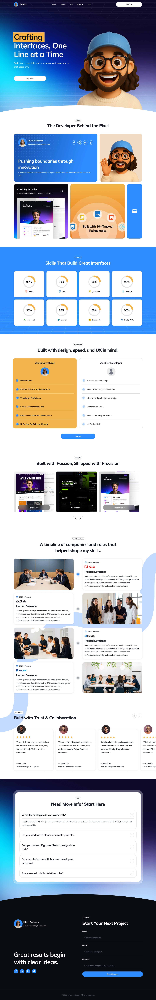

# Personal Developer Portfolio

**Crafting Interfaces, One Line at a Time.**

A modern personal developer portfolio website designed to showcase my technical skills, selected projects, professional experience, and passion for building meaningful digital experiences.

---

## Website Preview



## About The Project

This project is a personal portfolio website that represents my journey, skills, and experience as a developer.

Designed with a modern visual approach, the website combines clean layouts, playful illustrations, vibrant colors, and intuitive navigation to create an engaging user experience.

The portfolio serves as a central place to explore my background, technical capabilities, previous work, and opportunities for collaboration.

## Key Sections

- **Hero Section** – An introduction with a personal tagline and call-to-action.
- **About Me** – A visual introduction to the developer behind the projects.
- **Technical Skills** – A showcase of programming languages, frameworks, and development tools.
- **Personal Profile** – Information about my working style, interests, and availability.
- **Selected Projects** – A collection of projects highlighting my development capabilities.
- **Professional Experience** – A timeline showcasing my career journey and previous roles.
- **Testimonials** – Feedback and recommendations from people I have worked with.
- **FAQ** – Answers to common questions about my services and collaboration.
- **Contact Section** – An invitation to discuss ideas and potential projects.

## Tech Stack

The project is built using the following technologies:

| Technology | Purpose                        |
| ---------- | ------------------------------ |
| Next.js    | React framework                |
| React      | User interface development     |
| TypeScript | Type-safe development          |
| CSS        | Styling and responsive layouts |

## Project Structure

```text
Project1_Slicing_Portofolio/
├── app/
│   ├── portfolio/
│   │   └── page.tsx
│   ├── globals.css
│   ├── layout.tsx
│   └── page.tsx
├── public/
│   └── images and assets
├── .gitignore
├── eslint.config.mjs
├── next.config.ts
├── package.json
├── package-lock.json
├── postcss.config.mjs
└── tsconfig.json
```

## Getting Started

To run this project locally, follow these steps:

### 1. Clone the Repository

```bash
git clone https://github.com/riensdepila/Project1_Slicing_Portofolio.git
```

### 2. Navigate to the Project Directory

```bash
cd Project1_Slicing_Portofolio
```

### 3. Install Dependencies

```bash
npm install
```

### 4. Start the Development Server

```bash
npm run dev
```

Open your browser and visit:

http://localhost:3000

## Production Build

To create an optimized production build:

```bash
npm run build
```

To run the production server:

```bash
npm run start
```

## Deployment

The project can be deployed using [Vercel](https://vercel.com/), a deployment platform optimized for Next.js applications.

## Author

**riensdepila**

- GitHub: [@riensdepila](https://github.com/riensdepila)

---

_Great results begin with clear ideas._

If you find this project interesting, feel free to explore the repository and connect with me.

⭐ Don't forget to star the repository!
